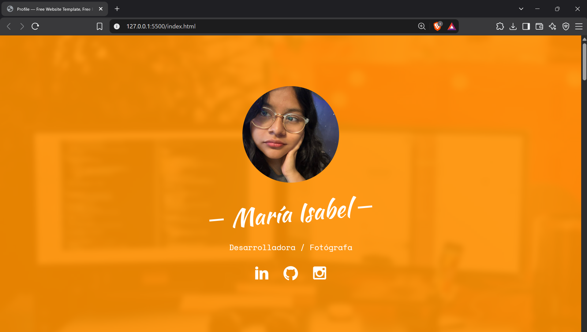
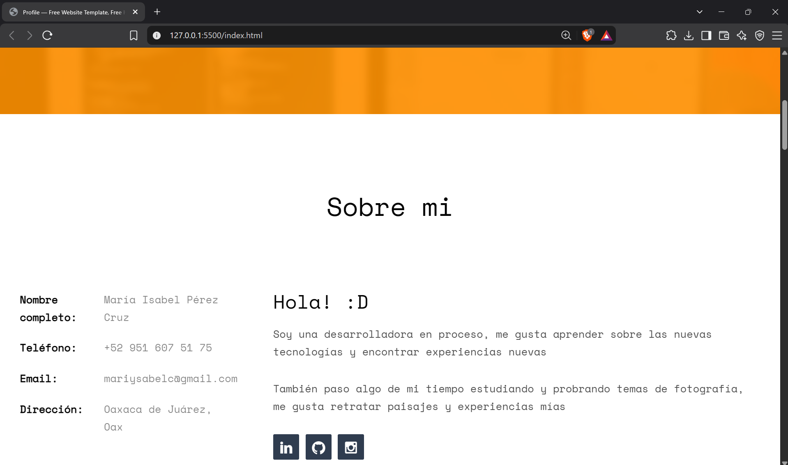
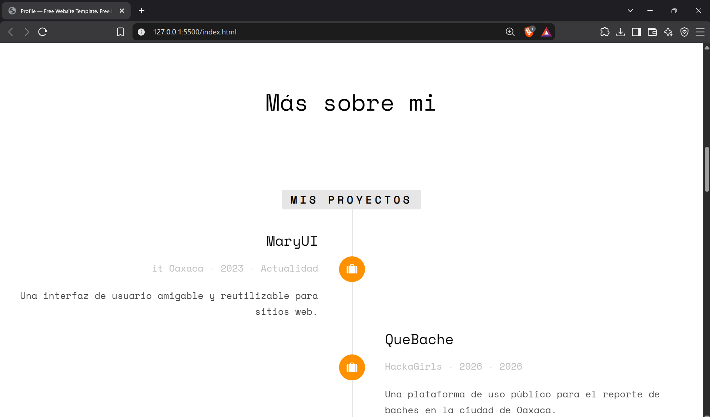
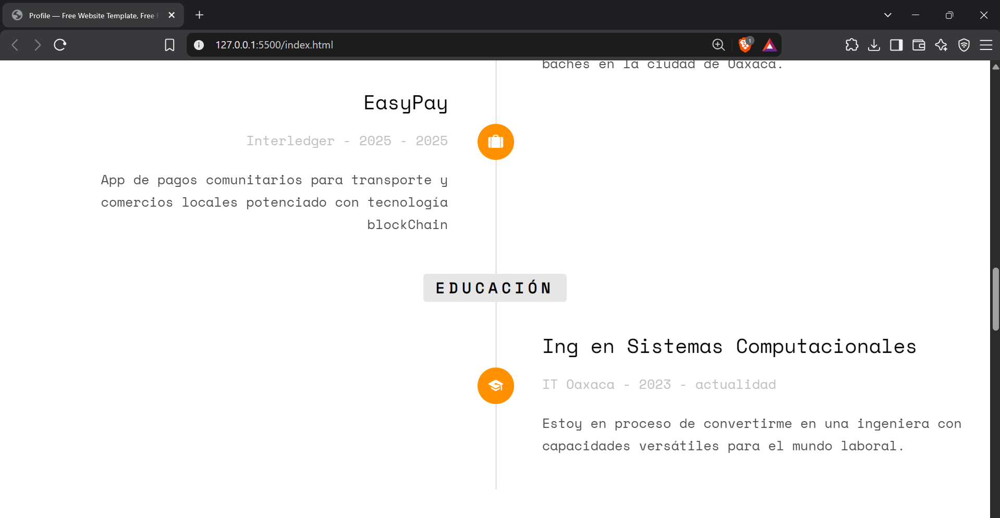
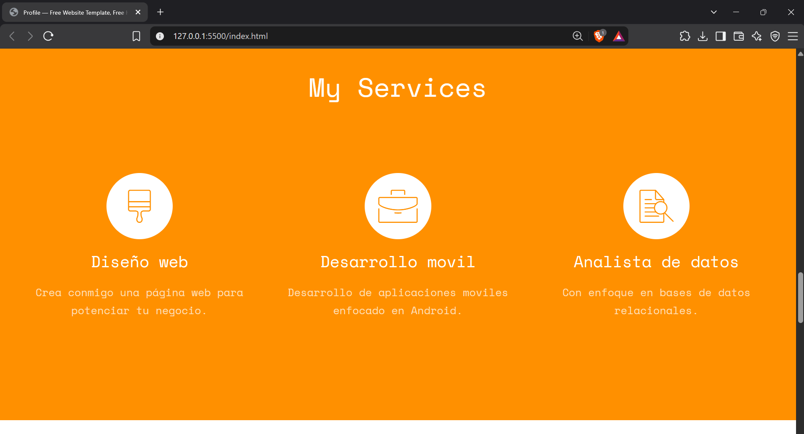
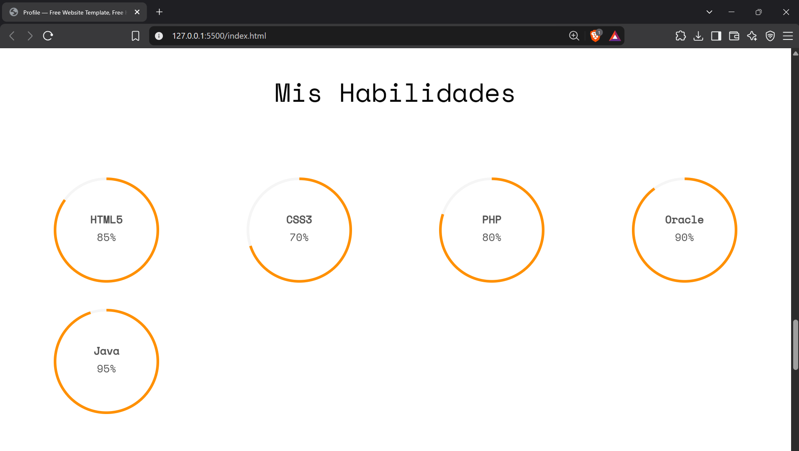
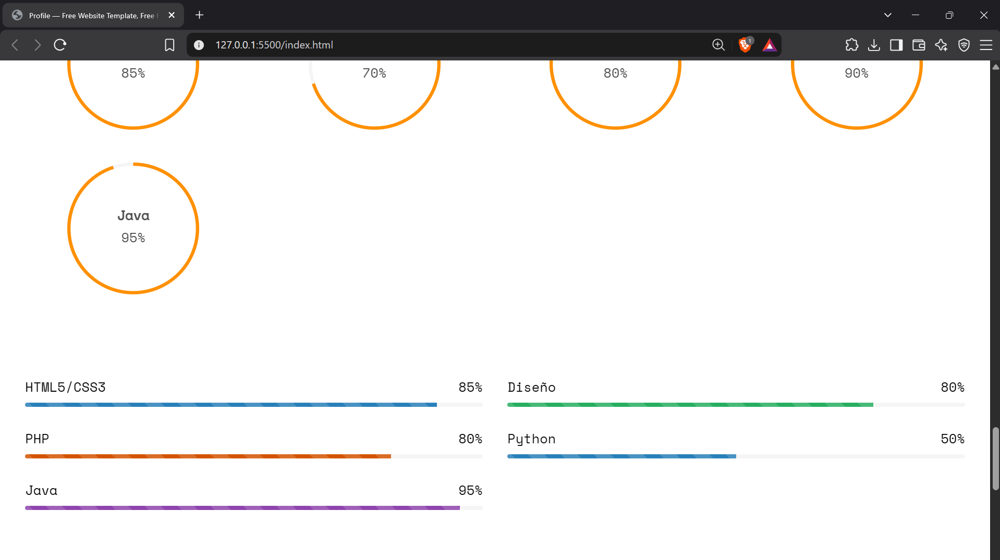

# Actividad 4. Portafolio Web con Bootstrap

Utilizando una plantilla desarrollada con **Bootstrap**, realicé mi propio portafolio web con el propósito de mostrar información sobre mi perfil, proyectos, educación, habilidades y áreas de interés.

La plantilla fue utilizada como base y posteriormente fue personalizada con mi información, imágenes, redes sociales, proyectos y habilidades.

## Plantilla utilizada

La plantilla utilizada para este proyecto es una plantilla gratuita de portafolio y currículum desarrollada con HTML, CSS, JavaScript y Bootstrap.

Puedes consultar y descargar la plantilla original en el siguiente enlace:

[Click para ver la plantilla utilizada](https://themewagon.com/themes/best-quality-free-portfolio-resume-bootstrap-template-download-profile/)

## Tecnologías utilizadas

Para realizar este proyecto se utilizaron las siguientes tecnologías:

- **HTML5:** estructura y contenido del portafolio.
- **CSS3:** estilos y apariencia visual.
- **Bootstrap:** diseño responsivo y estructura mediante clases.
- **JavaScript:** funcionamiento de las animaciones y componentes interactivos incluidos en la plantilla.

## Personalización

Para personalizar la plantilla fue necesario modificar diferentes secciones del código HTML y reemplazar la información original por mis propios datos.

### Información personal

Se modificó la sección **"Sobre mí"** para mostrar mis datos personales, así como una breve descripción sobre mí y mis intereses.

También se agregaron enlaces a mis redes sociales, incluyendo GitHub, LinkedIn e Instagram.

Ejemplo de la información agregada:

```html
<li>
    <span class="first-block">Nombre completo:</span>
    <span class="second-block">María Isabel Pérez Cruz</span>
</li>

<li>
    <span class="first-block">Teléfono:</span>
    <span class="second-block">+52 951 607 51 75</span>
</li>

<li>
    <span class="first-block">Email:</span>
    <span class="second-block">mariysabelc@gmail.com</span>
</li>

<li>
    <span class="first-block">Dirección:</span>
    <span class="second-block">Oaxaca de Juárez, Oax</span>
</li>
```

Además, se modificó la descripción personal para mostrar mis intereses en el desarrollo de software y la fotografía.

## Foto de perfil

La imagen de perfil de la plantilla original fue reemplazada por una imagen propia.

```html
<div class="profile-thumb" style="background: url(images/yop.jpeg);"></div>
```

También se modificó el nombre y la descripción que aparecen en la portada:

```html
<h1><span>María Isabel</span></h1>
<h3><span>Desarrolladora / Fotógrafa</span></h3>
```

## Redes sociales

Se agregaron enlaces a mis diferentes redes sociales para que puedan ser consultadas desde el portafolio.

```html
<ul class="fh5co-social-icons">
    <li>
        <a href="https://www.linkedin.com/in/mariysabel">
            <i class="icon-linkedin2"></i>
        </a>
    </li>

    <li>
        <a href="https://github.com/Mariysabel">
            <i class="icon-github2"></i>
        </a>
    </li>

    <li>
        <a href="https://www.instagram.com/mariysabelc/">
            <i class="icon-instagram"></i>
        </a>
    </li>
</ul>
```

## Proyectos

La sección de proyectos de la plantilla fue modificada para mostrar algunos de los proyectos en los que he trabajado.

Actualmente se muestran:

- **MaryUI:** una interfaz de usuario amigable y reutilizable para sitios web.
- **QueBache:** una plataforma de uso público para el reporte de baches en la ciudad de Oaxaca.
- **EasyPay:** una aplicación de pagos comunitarios para transporte y comercios locales.

La información de estos proyectos se agregó dentro de la línea de tiempo proporcionada por la plantilla.

Ejemplo:

```html
<h3 class="timeline-title">MaryUI</h3>
<span class="company">it Oaxaca - 2023 - Actualidad</span>

<div class="timeline-body">
    <p>Una interfaz de usuario amigable y reutilizable para sitios web.</p>
</div>
```

## Educación

También se modificó la sección de educación para agregar mi formación académica.

Actualmente se muestra la carrera de:

**Ingeniería en Sistemas Computacionales**

```html
<h3 class="timeline-title">
    Ing en Sistemas Computacionales
</h3>

<span class="company">
    IT Oaxaca - 2023 - actualidad
</span>
```

La descripción indica que actualmente me encuentro en proceso de formación como ingeniera en sistemas computacionales.

## Servicios

La sección de servicios fue personalizada para mostrar algunas de las áreas en las que tengo interés y conocimientos.

Se agregaron las siguientes categorías:

- **Diseño web**
- **Desarrollo móvil**
- **Análisis de datos**

Cada categoría cuenta con una breve descripción.

## Habilidades

La plantilla incluye una sección de habilidades representadas mediante porcentajes y barras de progreso.

Se modificaron los valores para representar diferentes tecnologías y áreas que forman parte de mi formación:

- HTML5
- CSS3
- PHP
- Oracle
- Java
- Diseño
- Python

Por ejemplo:

```html
<div class="chart" data-percent="95">
    <span>
        <strong>Java</strong>95%
    </span>
</div>
```

También se utilizaron barras de progreso para representar visualmente el nivel indicado para cada habilidad.

## Formulario de contacto

Finalmente, se conservó y personalizó la sección de contacto proporcionada por la plantilla. Esta sección contiene campos para:

- Nombre
- Apellido
- Correo electrónico
- Asunto
- Mensaje

Además, cuenta con un botón para enviar el formulario.

> **Nota:** El formulario corresponde al diseño visual proporcionado por la plantilla y no cuenta con un servidor propio para procesar los mensajes.

## Estructura del proyecto

La estructura general del proyecto se mantiene organizada de acuerdo con los archivos proporcionados por la plantilla:

```text
Portafolio/
│
├── index.html
│
├── css/
│   ├── bootstrap.css
│   ├── style.css
│   ├── animate.css
│   └── icomoon.css
│
├── js/
│   ├── main.js
│   ├── jquery.min.js
│   ├── bootstrap.min.js
│   ├── jquery.waypoints.min.js
│   ├── jquery.easypiechart.min.js
│   └── ...
│
└── images/
    ├── cover_bg_3.jpg
    ├── yop.jpeg
    └── contactme.jpg
```

## Resultado

El resultado final es un **portafolio web personalizado**. La plantilla permitió contar con una estructura visual y responsiva, mientras que las diferentes secciones fueron modificadas para representar mi información personal, formación académica, proyectos, habilidades e intereses.

### Capturas del portafolio















